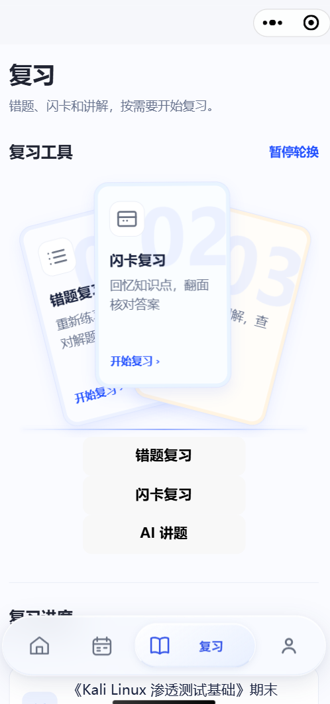
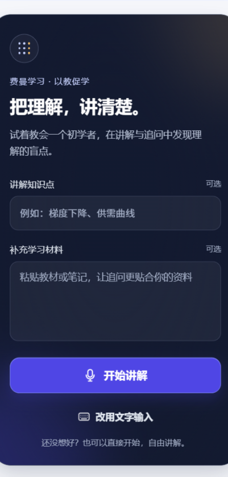

# ExamO · 易考鸥

**AI 伴学与备考助手 · AI study assistant for exam preparation**

企业项目（Enterprise Project）｜微信小程序（WeChat Mini Program）｜产品展示（Product Showcase）

[产品主页 / Website](https://chenb5408-bit.github.io/ExamO/) · [English](README.en.md) · [功能介绍](docs/features.md) · [技术架构](docs/architecture.md) · [安全说明](SECURITY.md)

## 项目介绍

ExamO（易考鸥）帮助学习者将课程资料转化为可练习、可回顾、可讲解的学习过程。围绕资料学习、练习作答、错题复习、闪卡与费曼讲解，串联“学—练—复习—反馈”，让备考更有条理。

本仓库是官方产品展示入口，仅发布经审查的产品资料。核心源码独立保存在受限访问的私有仓库中；此处不发布完整源码、运行凭据或内部部署信息。

## 核心功能

| 能力 | 学习价值 |
| --- | --- |
| 课程与学习资料 | 围绕课程整理资料和学习任务 |
| 资料识别与练习 | 解析学习资料并组织练习；上传原题按原题路径使用 |
| 在线作答与反馈 | 完成练习、查看结果并回顾薄弱知识 |
| 错题与闪卡复习 | 通过回忆和自评反复巩固理解 |
| 费曼讲解与 AI 追问 | 用自己的话讲清概念，在追问中发现理解盲点 |
| 学习记录与个性化复习 | 结合学习反馈持续安排后续复习 |

## 产品截图

以下为项目开发期间的界面截图，仅作功能展示；当前版本以实际体验为准。示例不展示真实用户账号、学习记录或上传资料。

| 复习工具 | 费曼讲解 |
| --- | --- |
|  |  |

## 技术架构概览

微信小程序 → 应用服务 → 学习与练习能力 → 数据持久化。文档解析与 AI 能力通过受控服务边界接入；供应商凭据保留在服务端。

技术栈概览：WeChat Mini Program、Node.js、Express、SQLite、文档解析与 AI 服务集成。详见[架构说明](docs/architecture.md)。

## 使用场景

- 日常课程学习后，整理资料并针对知识点练习。
- 考前集中复习，通过错题和闪卡回顾薄弱环节。
- 自学或培训时，用费曼讲解检查是否真正理解概念。

## 项目状态与入口

截至 2026-10-19，项目已完成开发（维护者说明），进入维护与产品展示阶段。本仓库不发布安装包或生产环境地址，也不代表已开放公众注册。

- 产品介绍：https://chenb5408-bit.github.io/ExamO/
- 反馈与产品咨询：[公开 Issue](https://github.com/chenb5408-bit/ExamO/issues/new/choose)，请勿提交私人资料。
- 维护者与合作联系：[GitHub 主页](https://github.com/chenb5408-bit)。尚未公布专用商务邮箱。
- 源码入口（仅授权成员可见）：[小程序端](https://github.com/chenb5408-bit/examo-miniapp) · [后端](https://github.com/chenb5408-bit/examo-backend)。无权限时 GitHub 显示 404 属正常行为。
- 小程序体验入口：由维护者向体验者提供；本页不虚构二维码、AppID 或上线状态。

## 安全与使用边界

请参阅 [SECURITY.md](SECURITY.md)。AI 内容仅供学习辅助，须结合权威教材核对。本仓库未添加开源许可证；产品展示不构成源码开放或再分发授权。

## English overview

ExamO is a WeChat Mini Program for AI-assisted learning and exam preparation. It brings course materials, practice, feedback, flashcard review and Feynman-style explanation into a connected study workflow. This enterprise product showcase publishes reviewed documentation and sample screens only. Core source repositories are private; credentials and internal deployment details are excluded. See the [English introduction](README.en.md).

**Search keywords:** ExamO, 易考鸥, 微信小程序, AI教育, AI伴学, 智能备考, 闪卡复习, 错题复习, 费曼学习法, AI education, exam preparation, study assistant, WeChat Mini Program, miniprogram.
