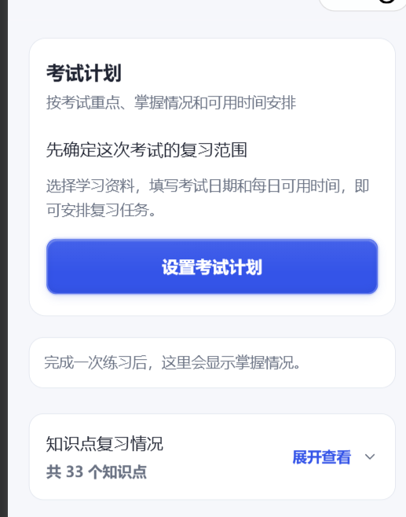
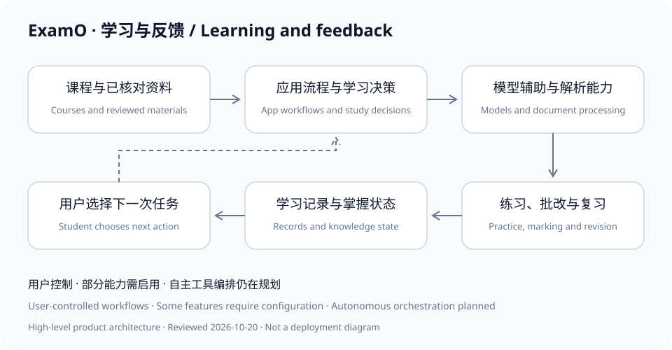

# ExamO · 易考鸥

**AI-assisted learning and exam preparation for university students · AI Study Agent project**

[中文](README.md) · [Product documentation](https://chenb5408-bit.github.io/ExamO/english.html) · [Features](FEATURES.md) · [Architecture](ARCHITECTURE.md) · [Agent design](AGENT.md)

ExamO connects a student's courses and learning materials with practice, feedback and continued revision. Students can work with textbooks, lecture materials, revision notes, papers and images, then use practice questions, mistakes, flashcards and Feynman-style explanations to check their understanding.

**Implementation review: October 20, 2026.** Core study workflows have code implementations. Planning and some adaptive capabilities require configuration. The current system combines user-controlled workflows, model assistance and rule-based decisions. Autonomous model-led tool selection and sustained execution remain planned. This review does not verify production release availability or educational outcomes.

## Product and company

**ExamO（易考鸥）is a study and revision WeChat Mini Program for university students, provided by 贵州初界计划科技有限公司 (Guizhou Chujie Plan Technology Co., Ltd.). The company brand is 初界计划 (Chujie Plan).**

- Official company website (yikaoou.cn): https://yikaoou.cn/
- Official ExamO product page: https://yikaoou.cn/examo/
- Official public documentation repository: https://github.com/chenb5408-bit/ExamO
- Business email: [chenbo@chujiejihua.cn](mailto:chenbo@chujiejihua.cn)

Business email uses the chujiejihua.cn domain; the company website uses yikaoou.cn. GitHub Pages hosts product documentation, with the official product entry on the company website above.

## Who it serves

University students often prepare for exams across separate course schedules, textbooks, notes and past papers. ExamO organizes this context and helps identify what to practice, which concepts remain uncertain and where to begin the next revision session.

Course import establishes course and timetable context, exam details and in-app cues. **It is separate from importing lecture materials or parsing papers**; entering a course name does not create a question bank.

## From materials to the next revision session

1. **Set the context:** choose a course, add exam details, study time and materials.
2. **Parse and review:** recognize documents, images or pasted text; review and confirm the result.
3. **Organize knowledge:** associate concepts and material evidence with the learning context.
4. **Plan and choose:** when enabled, planning services use exam timing, learning state and available time to suggest tasks. The student chooses what to start.
5. **Practice and reflect:** use generated practice, original questions, marking, mistake analysis, flashcards or Feynman explanations.
6. **Evaluate and adapt:** eligible answers and recall feedback update learning records; subsequent requests can recalculate training priorities and revision suggestions.

Uploaded papers and question collections follow an original-question workflow. Revision materials can support new practice questions. Estimated importance reflects supplied evidence, not a prediction of actual exam questions.

## Implemented capabilities

Implemented means code was found and reviewed; it does not mean a public release was verified. Configuration-dependent capabilities are identified explicitly. See [FEATURES.md](FEATURES.md).

| Capability | Implementation status | Boundary |
| --- | --- | --- |
| Document, image and text recognition | Implemented | Depends on format, services and source quality; review required |
| Material classification, subject context and concepts | Implemented | AI can misclassify; evidence is not an exam prediction |
| Material-based practice, original questions and mock exams | Implemented; some configuration-dependent | Preserve original questions; generate new practice from study materials |
| Marking, explanations and mistake analysis | Implemented | Some subjective marking uses models; uncertain grading must remain explicit |
| Mastery estimates, weak points and study records | Implemented | Study indicators, not authoritative assessment |
| Exam time budgets and task planning | Implemented, configuration-dependent | Uses available evidence, exam details and study time |
| Adaptive difficulty, priorities and review intervals | Implemented; some configuration-dependent | Recomputed from records; depends on evidence and user settings |
| Flashcards, AI explanations and Feynman practice | Implemented | User initiated; Feynman feedback is not real-time speech understanding |
| Course management and in-app class/exam cues | Implemented | Timetables need checking; background notifications are planned |

## How the agent project works

ExamO's AI Study Agent direction connects **perception → planning → execution → evaluation → adjustment**.

Materials and learning records provide context and memory. Data services and rules calculate priorities, time budgets and revision suggestions. After a student selects an action, the application invokes the corresponding study capability. Feedback can update records used by later recommendations.

This is currently a **user-controlled, rule-orchestrated workflow with model assistance**. The review did not find a complete model-directed tool-selection loop or a single autonomous controller coordinating every flashcard, Feynman and reminder capability. See [AGENT.md](AGENT.md).

## Product views

These authentic screenshots were supplied by the maintainer to illustrate the product interface. They do not establish production release availability, recognition accuracy, educational outcomes or autonomous agent capabilities. On-screen counts, self-assessments and mastery indicators are not product adoption or effectiveness statistics.

| Home and material entry | Revision tools |
| --- | --- |
|  |  |

| Flashcards and recall feedback | Feynman explanation practice |
| --- | --- |
|  |  |

[Full gallery and provenance](docs/screenshots.md). Official brand artwork and demonstration video can be added after rights and privacy review.

## Architecture at a glance

| Layer | Reviewed technology and responsibility |
| --- | --- |
| Student interface | Native WeChat Mini Program for courses, materials, practice and revision |
| Application services | Node.js and Express for authentication and workflow coordination |
| Material processing | Document parsing and OCR, including Python processing components |
| Learning data | SQLite using Node.js's built-in SQLite interface at runtime |
| Study decisions | Knowledge state, priorities, time budgets, practice and revision services |
| Model assistance | Server-side model integration, including DeepSeek, for generation, explanation and feedback |

[ARCHITECTURE.md](ARCHITECTURE.md) describes responsibilities without exposing internal endpoints, deployment details, prompts, schemas or commercial decision parameters.

## Product approach

ExamO starts with the student's own courses and materials. Practice results can inform subsequent diagnosis, training and revision suggestions. Flashcards support active recall; Feynman practice supports explaining a concept. Original questions remain distinct from AI-generated practice.

These are implementation findings and design choices, not evidence of superiority, exclusive differentiation or guaranteed grades. The [product-context document](docs/product-comparison.md) provides objective references for research into tools such as Quizlet and StudyFetch.

## Privacy and safety

- Core application source remains in private commercial repositories. This repository is for product information and public discovery.
- Upload only materials you have permission to use, removing names, student numbers and unrelated details.
- Processing may involve servers and external services. This page does not claim entirely on-device processing; consult the application's current privacy notice and permissions.
- Generated questions, marking, explanations and recommendations may be wrong. Check textbooks, original papers and course requirements. Mastery estimates do not predict exam grades.
- Report security issues through [private vulnerability reporting](https://github.com/chenb5408-bit/ExamO/security/advisories/new), never by posting credentials or learning records publicly. See [SECURITY.md](SECURITY.md).

## Version and milestones

Both application package manifests currently report **1.0.0**. Package metadata is not a production release certificate. This update changes public documentation only; it does not implement V5 or alter business logic.

| Date | Verifiable milestone |
| --- | --- |
| October 19, 2026 | Public documentation baseline, course-aware positioning, bilingual material and product-information site |
| October 20, 2026 | Current private default branches reviewed; feature, architecture, agent-boundary and intellectual-property documents expanded |

Next priorities include release evidence, trial access, configuration acceptance and feedback-loop validation. Autonomous multi-tool orchestration and background notifications remain development directions. See [ROADMAP.md](ROADMAP.md) and [CHANGELOG.md](CHANGELOG.md).

## Official links and contact

- [Company website: 初界计划](https://yikaoou.cn/)
- [Official ExamO product page](https://yikaoou.cn/examo/)
- Business inquiries: [chenbo@chujiejihua.cn](mailto:chenbo@chujiejihua.cn)
- [Product information website](https://chenb5408-bit.github.io/ExamO/english.html)
- [Official public repository](https://github.com/chenb5408-bit/ExamO)
- [Product feedback and initial collaboration inquiries](https://github.com/chenb5408-bit/ExamO/issues/new/choose)
- [Maintainer and trial-access inquiries](https://github.com/chenb5408-bit)
- [Contribution and correction guidelines](CONTRIBUTING.md)

Contact the maintainer to confirm trial access. The website is an information resource, not confirmation of open registration. Public accessibility does not guarantee search indexing, AI citations or recommendations.

## Brand and intellectual property

ExamO's core source remains a private commercial asset. Publishing this repository does not make the product open source or grant rights to reproduce, modify or redistribute its code, brand or assets. No open-source license has been added. See [NOTICE.md](NOTICE.md).
